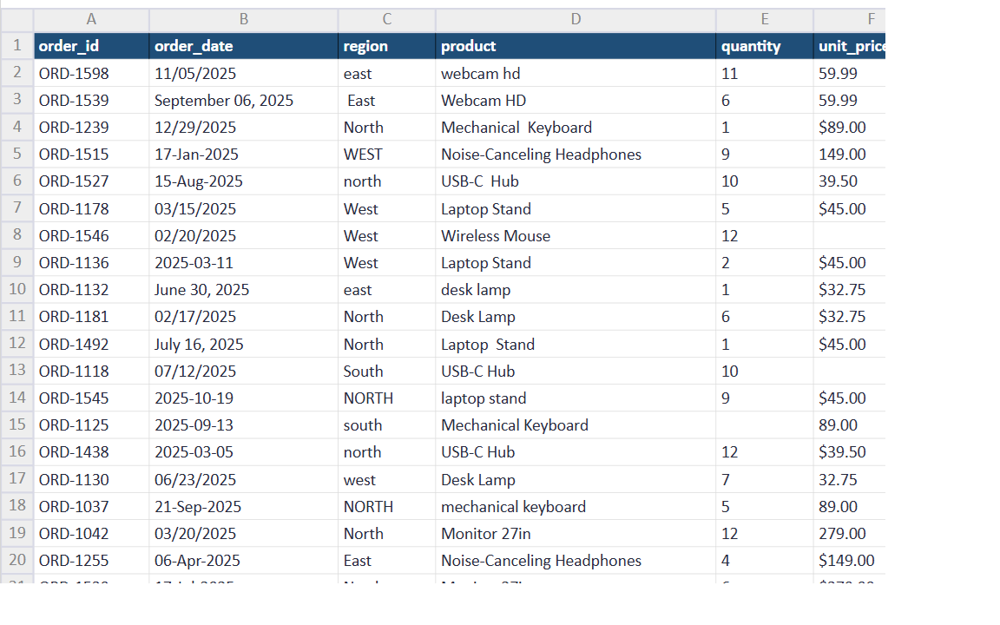
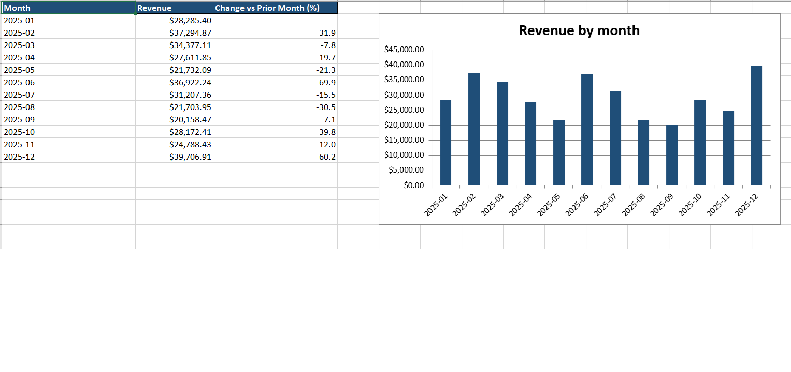

# Sales Report Automator

[](https://github.com/datalogicpro/sales-report-automator/actions/workflows/tests.yml)

Turns a messy sales export into a clean, formatted Excel report in seconds.

**Live demo:** [datalogicpro-sales-report.streamlit.app](https://datalogicpro-sales-report.streamlit.app)

## Before and after

**Before:** the raw sales export, with mixed date formats, inconsistent region names, prices stored as text, duplicate rows, and blank cells.



**After:** the finished Excel report, with cleaned data, summary tables, and charts.



## The problem

Many small businesses rebuild the same sales report by hand every week. The raw exports are messy: dates in different formats, misspelled regions, prices stored as text, duplicate rows, and blank cells. Cleaning that by hand takes hours and is easy to get wrong.

## What it does

- **Reads many file types:** CSV, tab-separated, semicolon-separated, pipe-separated, and Excel (.xlsx). It detects the separator automatically.
- **Cleans the data:**
  - Makes region names consistent (`WEST`, ` west `, `Wes` all become `West`)
  - Turns text like `$2,790.00` into real numbers
  - Converts four different date styles into one real date format
  - Makes product names consistent
  - Removes duplicate rows
  - Fills in blanks that can be calculated (revenue = quantity x price) and labels missing sales reps as "Unassigned"
- **Builds summaries:** revenue by month (with change from the previous month), by product, and by region.
- **Saves a formatted Excel report** with a chart on each summary sheet.
- **Explains problems clearly:** a missing file, an unreadable file, or missing columns each get a plain message instead of a crash.

## Results on the sample file

| | Before | After |
|---|---|---|
| Rows | 618 | 600 (18 duplicates removed) |
| Region spellings | 20 | 4 |
| Product spellings | 24 | 8 |
| Date formats | 4 | 1 |
| Blank quantities | 13 | 1 |
| Blank prices | 51 | 4 |
| Blank revenue amounts | 58 | 5 |
| Blank sales reps | 23 | 0 |

The few blanks left are rows missing two of the three numbers (quantity, price, revenue), so they can't be calculated.

## Web page

The web page runs the same cleaning steps in the browser:

- Try the included sample file, or upload your own
- See the rows before and after, and how many duplicates were removed
- Look through the monthly, product, and region summaries with charts
- Download the finished Excel report

## Input file

The file needs these columns. Other columns are kept as they are. Column names can use any capitals or extra spaces.

| Column | Example |
|---|---|
| `order_date` | `2025-05-17`, `05/17/2025`, `17-May-2025`, or `May 17, 2025` |
| `region` | `West` |
| `product` | `Laptop Stand` |
| `quantity` | `7` |
| `unit_price` | `$45.00` |
| `revenue` | `315.00` |
| `sales_rep` | `Carla Nguyen` |

## How to run

1. Install [uv](https://docs.astral.sh/uv/getting-started/installation/).

2. Install the libraries:

```
   uv sync
```

3. Run the program on a raw sales file:

```
   uv run python generate_report.py sample_csv_data.csv
```

   The report is saved to `output/sales_report.xlsx`. To save it somewhere else, add `--output`, for example `--output reports/may.xlsx`.

4. Or start the web page:

```
   uv run streamlit run app.py
```

## The report

The Excel file has four sheets:

- **Monthly:** revenue by month, percent change from the previous month, and a chart
- **Products:** revenue by product, biggest first, with a chart
- **Regions:** revenue by region, with a chart
- **Clean Data:** all cleaned rows, with filters

## Development

Run the tests, which require 100% coverage:

```
uv run pytest
```

Run the code checks:

```
uv run ruff check .
uv run ruff format --check .
uv run mypy .
uv run pip-audit
```

Turn on the checks that run before each commit:

```
uv run pre-commit install
```

GitHub Actions runs the checks and tests on every pull request, and Dependabot keeps the dependencies up to date.

## Built with

Python, pandas, xlsxwriter, openpyxl, Streamlit, and uv.

## License

MIT. See [LICENSE](LICENSE).

## Author

datalogicpro
